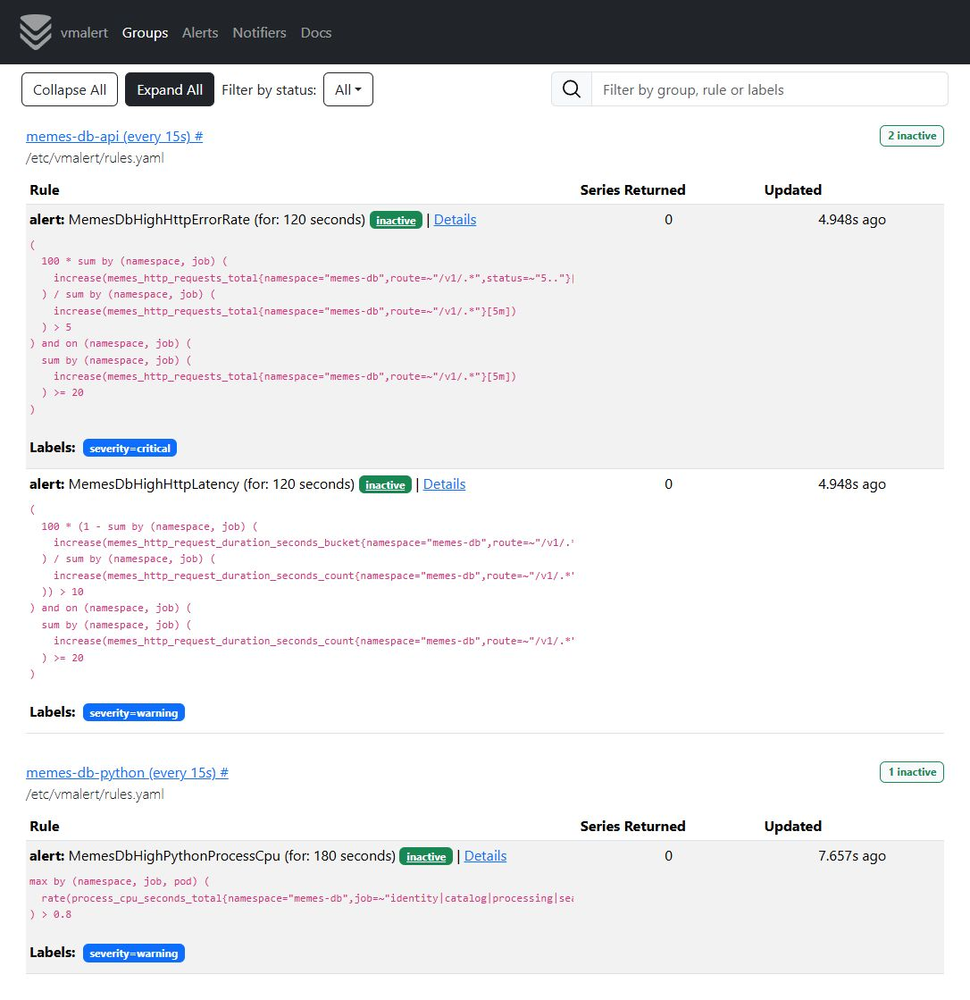
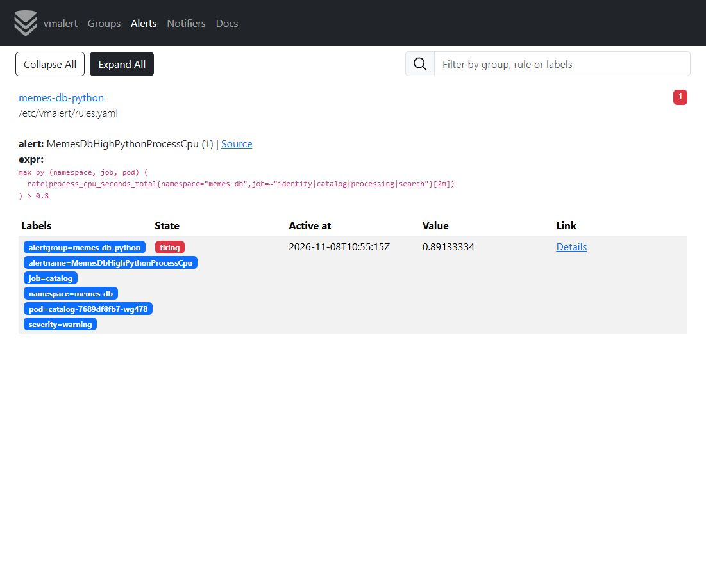
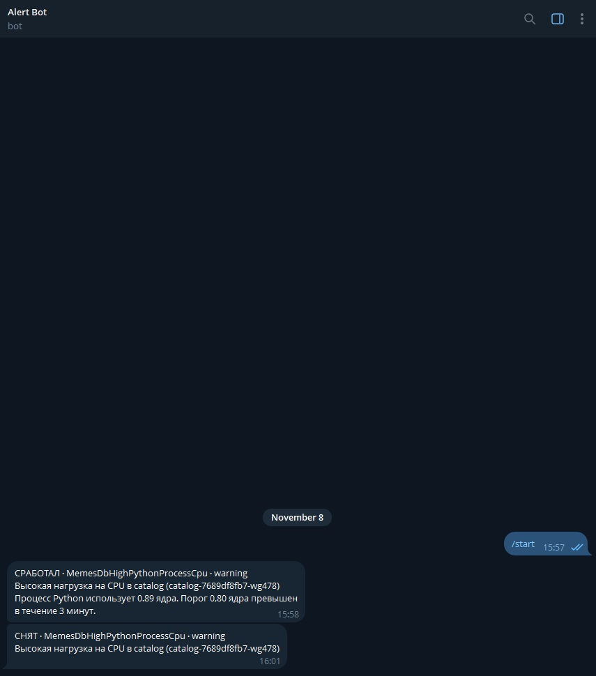

# ДЗ 6. Алерты по метрикам и уведомления в Telegram

Отдельный `vmalert-metrics` читает ряды из VictoriaMetrics. Экземпляр `vmalert`
из ДЗ 3 продолжает проверять логи в VictoriaLogs. Оба отправляют алерты
в общий Alertmanager. Он доставляет уведомления о срабатывании и снятии
в Telegram.

[Правила по метрикам](../deploy/k8s/observability/config/metric-rules.yaml) ·
[Конфигурация Alertmanager](../deploy/k8s/observability/config/alertmanager.yaml) ·
[Манифесты наблюдаемости](../deploy/k8s/observability/)

## Правила

| Правило | Условие | Почему |
| --- | --- | --- |
| `MemesDbHighHttpErrorRate` | Доля `5xx` выше 5% за 5 минут. Условие сохраняется 2 минуты. | Позволяет заметить массовые серверные отказы в конкретном API. |
| `MemesDbHighHttpLatency` | Доля запросов дольше 1 секунды выше 10% за 5 минут. Условие сохраняется 2 минуты. | Замечает деградацию при успешных ответах. Граница в 1 секунду взята из SLI задержки ДЗ 5. |
| `MemesDbHighPythonProcessCpu` | Среднее потребление процесса Python за 2 минуты выше 0,8 ядра. Условие сохраняется 3 минуты. | Позволяет обнаружить устойчивую нагрузку на конкретный Pod. Лимит контейнера каждого API равен 1 ядру. |

HTTP-правила рассматривают маршруты `/v1/…` отдельно по каждому API. Для
оценки требуется не менее 20 запросов за 5 минут. `increase` вычисляется
до суммирования, чтобы сброс счётчика отдельного Pod учитывался отдельно.
Задержка вычисляется по общему счётчику гистограммы и бакету `le="1.0"`.
Пороговые доли предназначены для оперативной реакции. Месячные SLO
проверяются на дашборде ДЗ 5.

CPU измеряется по `process_cpu_seconds_total`, который `ProcessCollector`
в Python экспортирует через `/metrics`. Значение `rate` выражено в секундах
CPU на секунду реального времени. Значение `0.8` соответствует 80% одного ядра.

## Развёртывание в minikube

Нужны работающие приложение и [мониторинг из ДЗ 5](<Отчет №5.md>).

Если Secret ещё не создан, скопируйте шаблон в `deploy/k8s/.local/`.
Этот каталог исключён из Git.
[Шаблон Telegram Secret](../deploy/k8s/observability/secrets.example.yaml).

```shell
mkdir -p deploy/k8s/.local
install -m 600 deploy/k8s/observability/secrets.example.yaml deploy/k8s/.local/alertmanager-telegram.yaml
```

В копии подставьте токен в `bot-token`, а идентификатор чата в `chat-id`.

```shell
kubectl apply -f deploy/k8s/observability/namespace.yaml
kubectl create -f deploy/k8s/.local/alertmanager-telegram.yaml
```

Если Secret уже настроен, начните с применения манифестов.

```shell
kubectl apply -k deploy/k8s/observability
kubectl -n observability wait --for=condition=Available deployment --all --timeout=180s
kubectl -n observability rollout status daemonset/vector --timeout=180s
```

Alertmanager читает токен и идентификатор чата из смонтированного Secret.
Исходящие запросы Alertmanager к `api.telegram.org` должны быть доступны
из кластера.

## Проверка

```shell
kubectl -n observability exec deployment/alertmanager -- /bin/amtool check-config /etc/alertmanager/alertmanager.yaml
kubectl -n observability port-forward service/vmalert-metrics 8881:8880
```

В [vmalert](http://127.0.0.1:8881/vmalert/groups) видны две группы с тремя
правилами. Кнопка **Expand All** показывает запросы и текущее состояние.



### Нагрузка на процесс Python

На локальном стенде отправьте параллельные запросы к `/health/live`
сервиса Catalog через `curl` из контейнера S3. Нагрузка завершается
по тайм-ауту. Маршрут исключён из расчёта HTTP-алертов.

```shell
kubectl -n memes-db exec s3-0 -- timeout 310s curl \
  --parallel --parallel-max 48 --no-progress-meter --show-error --max-time 6 \
  --output /dev/null 'http://catalog:8080/health/live?probe=[1-1000000]' >/dev/null
```

В разделе **Alerts** значение CPU показано в ядрах. После первого
превышения порога состояние меняется на `pending`. После трёх минут
непрерывного превышения правило переходит в `firing`.

На стенде CPU процесса Catalog достиг 0,89 ядра, и правило перешло
в `firing`. После окончания нагрузки правило вернулось в `inactive`.
Alertmanager доставил в Telegram оба уведомления. Счётчик доставок
увеличился до двух, счётчики ошибок доставки остались нулевыми.



