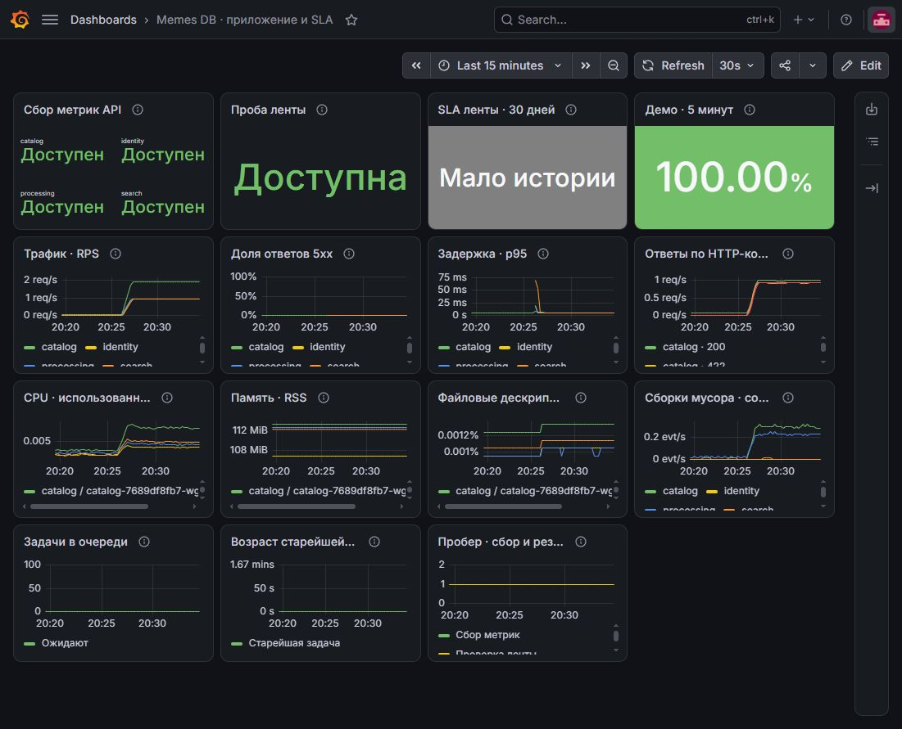
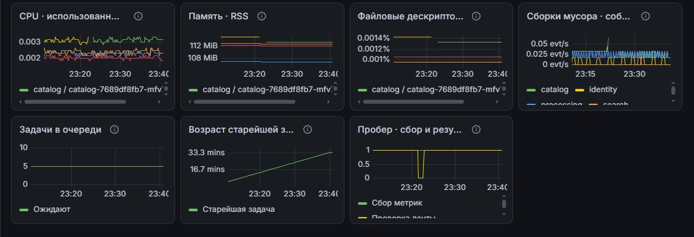
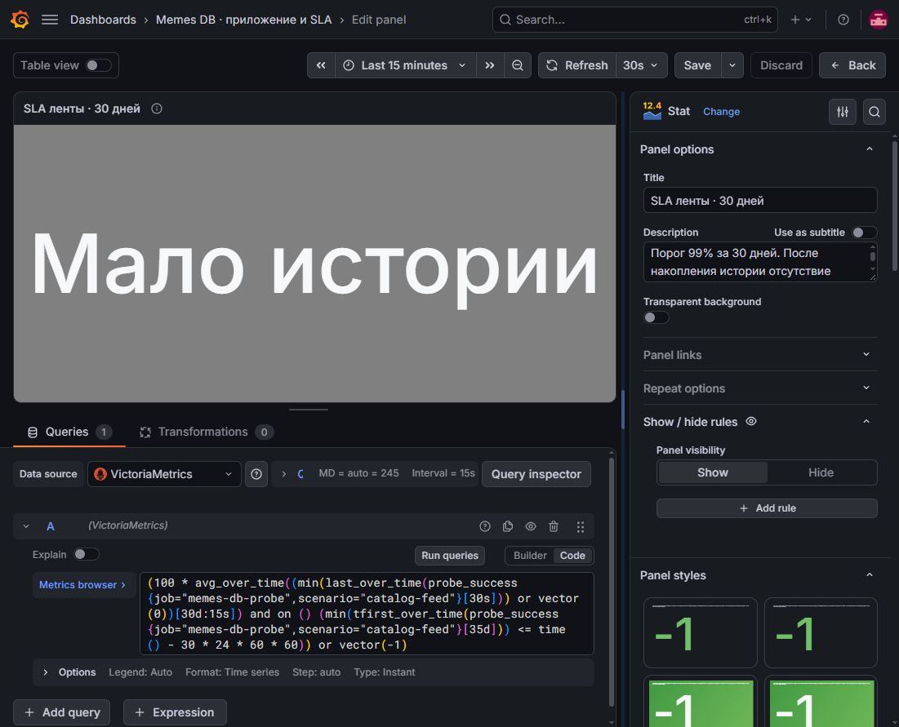
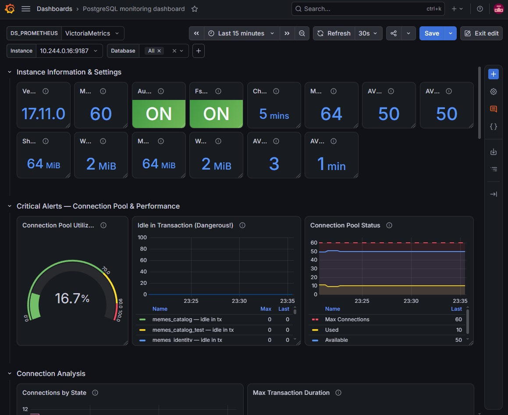

# ДЗ 7. Дашборды Grafana для Memes DB

Развернул Grafana в minikube и подключил VictoriaMetrics. В веб-редакторе
Grafana создал дашборд "Memes DB · приложение и SLA" и скачал его JSON.
Проверил панели приложения и импортированного дашборда PostgreSQL Exporter.
[Экспорт JSON](../deploy/k8s/monitoring/grafana-memes-db.json),
[настройки Helm](../deploy/k8s/monitoring/grafana-values.yaml).

## Запуск

```shell
helm repo add grafana-community https://grafana-community.github.io/helm-charts
helm repo update grafana-community
helm upgrade --install grafana grafana-community/grafana --version 14.4.1 \
  --namespace monitoring -f deploy/k8s/monitoring/grafana-values.yaml
kubectl -n monitoring rollout status deployment/grafana --timeout=300s
```

Grafana хранит настройки и сохранённые дашборды на PVC.
Открываем локальный доступ через `port-forward`.

```shell
kubectl -n monitoring port-forward service/grafana 3000:80
```

В отдельном терминале читаем сгенерированный Helm пароль пользователя `admin`.

```shell
kubectl -n monitoring get secret grafana -o jsonpath="{.data.admin-password}" | base64 --decode
```

Открываем [Grafana](http://127.0.0.1:3000/). В Connections > Data sources
доступен источник `VictoriaMetrics` с UID `victoria-metrics`. Grafana
обращается к `http://victoria-metrics.monitoring.svc:8428` через встроенный
источник типа Prometheus. Запросы исполняет VictoriaMetrics. vmagent каждые
15 секунд собирает метрики API, PostgreSQL Exporter и blackbox-exporter.
Оба дашборда используют этот источник.

## Приложение

Создал новый дэшборд и добавил 15 панелей с источником запросов `VictoriaMetrics`. 
Для текущих статусов и SLA выбрал Stat и Instant. Для графиков выбрал 
Time series и Range. Задал легенды, единицы измерения и цвета состояний. 
Сохранил диапазон Last 15 minutes и автообновление 30s.

Выгрузил дэшборд. Скачанный файл сохранил как `grafana-memes-db.json`.

- **Статусы API и проба ленты.** Видно, с каких сервисов собираются метрики и открывается ли публичная лента.
- **RPS, коды ответов, 5xx и p95.** Видно, сколько запросов приходит, как часто возникают серверные ошибки и сколько времени занимают ответы.
- **Ресурсы Python и очередь Processing.** CPU, память, файловые дескрипторы и сборки мусора показывают нагрузку на процессы. Длина очереди и возраст старейшей задачи помогают заметить, что обработка отстаёт.





## SLA ленты

Панель **SLA ленты · 30 дней** показывает долю успешных проверок публичной
ленты за месяц. Цель - 99%. Сбой или отсутствие свежей пробы считаются
отказом.

Пока данных за 30 дней мало, панель показывает **Мало истории**.
Для примера рядом вывел тот же расчёт за 5 минут. На скриншоте получилось 100%.



## PostgreSQL Exporter

В Grafana импортировал дашборд по ID `24919` и выбрал `VictoriaMetrics`.
На графиках видно число подключений, сколько транзакций завершается
коммитом или откатом и сколько места занимают базы.
[Дашборд из каталога Grafana](https://grafana.com/grafana/dashboards/24919-postgresql/).


