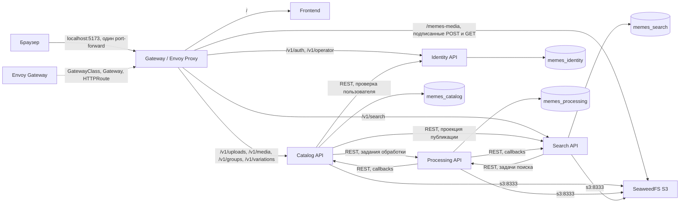

# Развёртывание Memes DB в minikube

## Состав стенда

Подготовлены манифесты для одного узла minikube с Docker driver и containerd.
Frontend, четыре API и четыре фоновых процесса имеют по одной реплике.
PostgreSQL с pgvector и SeaweedFS также имеют по одной реплике. ML-воркеры,
GPU и веса моделей не используются. Точка входа реализована через Gateway API
с контроллером Envoy Gateway и одним Envoy Proxy. У контроллера и прокси
также по одной реплике.

## Абстракции Kubernetes

| Абстракция | Назначение |
| --- | --- |
| Namespace `memes-db` | Изолирует ресурсы приложения внутри профиля `minikube`. |
| Namespace `envoy-gateway-system` | Содержит контроллер Envoy Gateway, управляемый Envoy Proxy и внутренние сертификаты. |
| CustomResourceDefinition | Добавляет в API Kubernetes типы Gateway API и настройки Envoy Gateway. |
| GatewayClass `memes-db-envoy` | Выбирает контроллер `gateway.envoyproxy.io/gatewayclass-controller` и конфигурацию прокси. |
| EnvoyProxy `memes-db-proxy` | Задаёт одну реплику прокси, ресурсы контейнеров и Service `memes-db-gateway` типа ClusterIP. |
| Gateway `memes-db` | Создаёт HTTP listener на порту 80 с hostname `localhost`; принимает маршруты своего namespace. |
| HTTPRoute | Направляет публичные API, медиа и UI в нужные backend Services по префиксам пути. |
| ServiceAccount и RBAC | Разрешают контроллеру наблюдать Gateway API и управлять инфраструктурой прокси. |
| Deployment | Управляет frontend, API Identity/Catalog/Processing/Search, Identity outbox, Catalog maintenance, Processing coordinator и Search maintenance. |
| ReplicaSet и Pod | Создаются контроллерами Deployment; каждый процесс приложения работает в отдельном Pod. |
| Service типа ClusterIP | Даёт стабильные DNS-имена API, frontend, PostgreSQL и S3. |
| Headless Service | Используется StatefulSet для стабильной сетевой идентичности PostgreSQL и S3. |
| StatefulSet | Сохраняет идентичность `postgres-0` и `s3-0` и повторно подключает их постоянные тома. |
| PVC и PV | По одному PVC размером 2 ГиБ для PostgreSQL и S3; локальные PV создаёт provisioner minikube класса `standard`. |
| Job | `bootstrap` готовит S3 buckets и выполняет миграции; `eg-gateway-helm-certgen` генерирует внутренние сертификаты Envoy Gateway. |
| ConfigMap | Хранит несекретные настройки backend/frontend и скрипт первичной подготовки PostgreSQL. |
| Secret | Хранит общие внутренние/S3 ключи, пароли ролей и отдельные DSN сервисов. |
| startup/readiness/liveness probes | Отделяют запуск контейнера, готовность API обслуживать запросы и живость процесса. |
| requests и limits | Задают резерв ресурсов и предел потребления каждого контейнера. |
| emptyDir | Предоставляет временный writable-каталог контейнерам с read-only корневой файловой системой. |

Каждый Deployment использует `Recreate`: обновление останавливает старый Pod
перед созданием нового, что уменьшает пиковую потребность в ресурсах. Это
учебный компромисс с коротким перерывом в обслуживании. Автоматическое
масштабирование не настроено. Публичную маршрутизацию выполняет Gateway API.

## Взаимодействие сервисов

