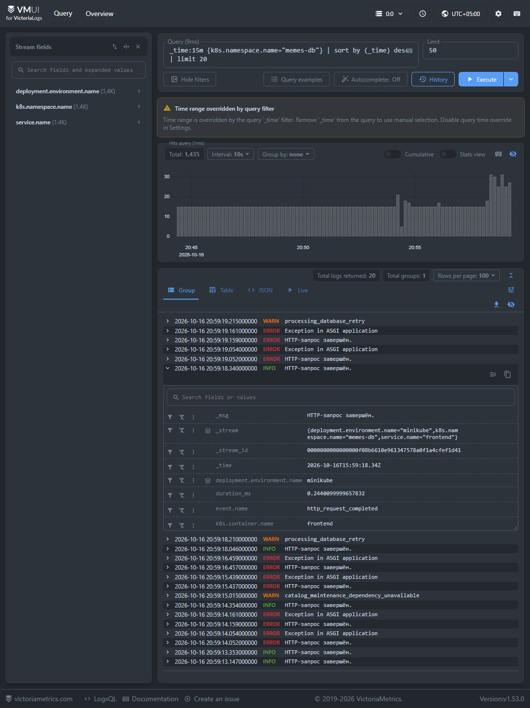
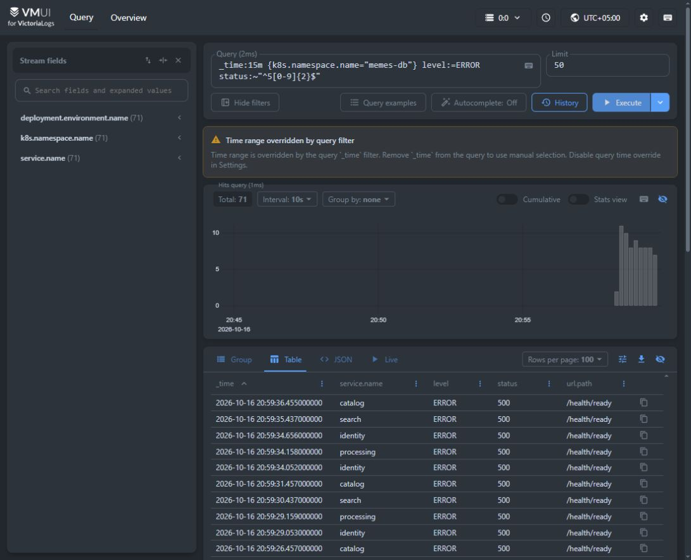
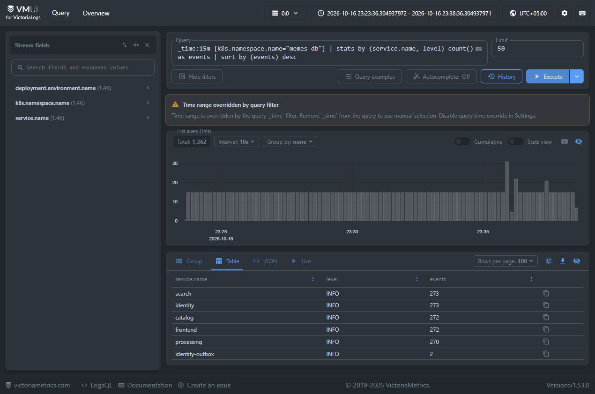
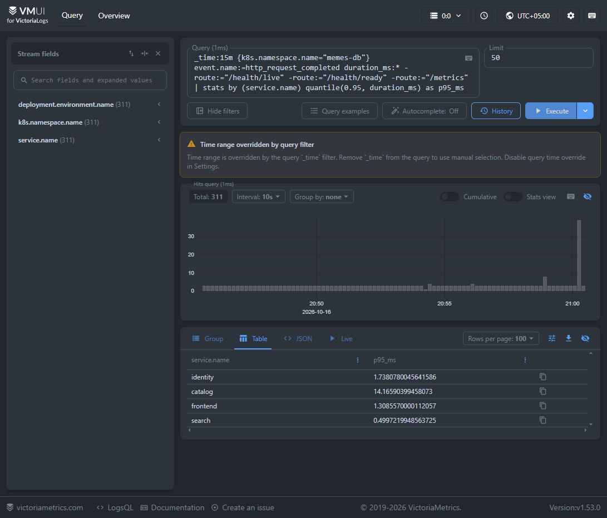
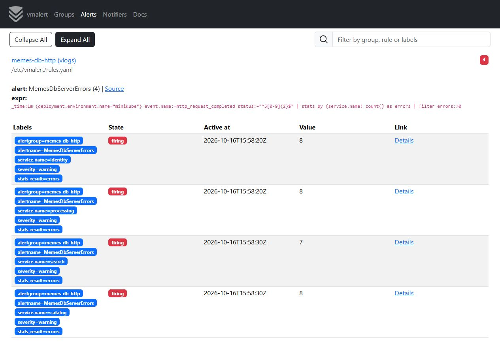
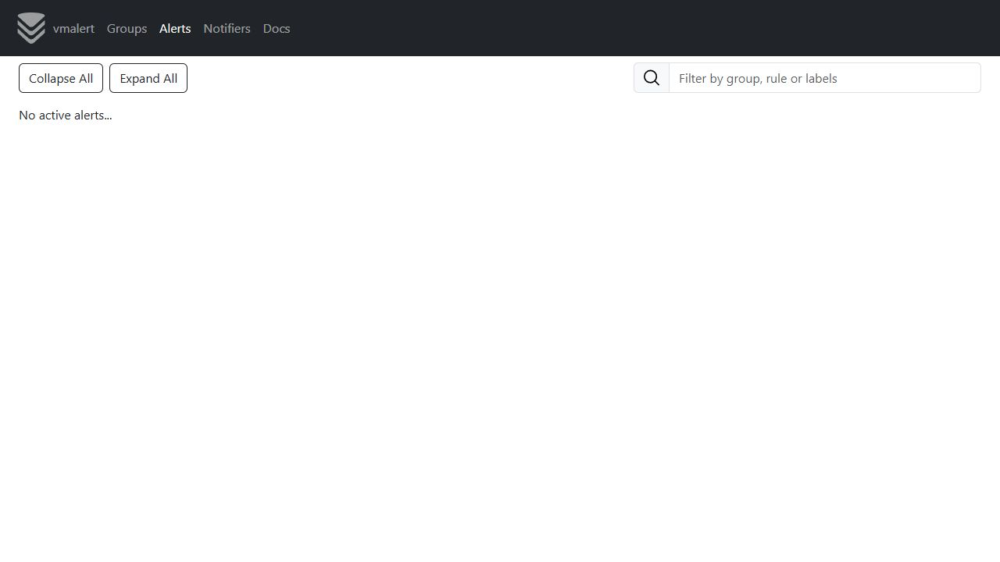

# ДЗ 3. Сбор логов в Kubernetes

Развернул VictoriaLogs, Vector и vmalert с Alertmanager в том же minikube,
где работает приложение.
[Манифесты и конфиги](deploy/k8s/observability/).

## Запуск

PostgreSQL, S3, Secrets и Gateway уже настроены в предыдущей ДЗ.
Команды выполняются из корня проекта.

Если образы ещё не собраны и не загружены в minikube:

```shell
docker build --file deploy/Dockerfile --target backend --build-arg RELEASE_ID=task-03-v2 --tag memes-db-backend:task-03-v2 .
docker build --file frontend/Dockerfile --build-arg RELEASE_ID=task-03-v2 --tag memes-db-frontend:task-03-v2 frontend
minikube image load memes-db-backend:task-03-v2
minikube image load memes-db-frontend:task-03-v2
```

После этого применяем манифесты:
```shell
kubectl apply -f deploy/k8s/config.yaml -f deploy/k8s/api.yaml -f deploy/k8s/background.yaml -f deploy/k8s/frontend.yaml
kubectl -n memes-db rollout restart deployment -l app.kubernetes.io/part-of=memes-db
kubectl -n memes-db rollout status deployment -l app.kubernetes.io/part-of=memes-db --timeout=180s
kubectl apply -k deploy/k8s/observability
kubectl -n observability wait --for=condition=Available deployment --all --timeout=180s
kubectl -n observability rollout status daemonset/vector --timeout=180s
```

Перезапуск подов нужен, чтобы они получили новый образ при повторной сборке
с тем же tag. VictoriaLogs работает в single-node режиме: PVC 2 ГиБ,
хранение логов 7 дней. Версии компонентов закреплены в манифестах.

Каждый port-forward запускается в отдельном терминале:

```shell
kubectl --context minikube -n envoy-gateway-system port-forward --address 127.0.0.1 service/memes-db-gateway 5173:80
kubectl --context minikube -n observability port-forward --address 127.0.0.1 service/victorialogs 9428:9428
kubectl --context minikube -n observability port-forward --address 127.0.0.1 service/vmalert 8880:8880
kubectl --context minikube -n observability port-forward --address 127.0.0.1 service/alertmanager 9093:9093
```

[Приложение](http://localhost:5173/)  
[vmui](http://127.0.0.1:9428/select/vmui/)  
[vmalert](http://127.0.0.1:8880/vmalert/alerts)  
[Alertmanager](http://127.0.0.1:9093/)

## Как собираются логи

Приложение пишет JSON в stdout. Vector DaemonSet читает `/var/log/pods`,
разбирает JSON, добавляет метаданные Kubernetes и отправляет записи
в VictoriaLogs через `/insert/jsonline`. Один сборщик на узел охватывает
API, frontend и фоновые процессы: отдельные sidecar и отправка логов
из кода сервисов не нужны. Сбор ограничен namespace `memes-db` и метками приложения.

В логах есть время UTC с миллисекундами, уровень, сообщение и его шаблон,
имя сервиса, версия и окружение. Для HTTP добавлены `request_id`, метод,
маршрут, путь ресурса, статус и `duration_ms`. Ошибки содержат `error.type`,
`error.message` и стек с цепочкой причин. Ожидаемые 4xx пишутся как INFO,
5xx и непредвиденные исключения - как ERROR. Трейсинг не настраивался.

Ссылки на ресурсы сохраняются. Маскируются пароли, токены и подписи в URL.
Тела запросов, заголовки авторизации, SQL-параметры и локальные переменные в лог не попадают.

## Запросы LogsQL

Запросы выполнены в vmui. `_time:15m` - последние 15 минут на момент запуска.
Время на скриншотах - UTC+05:00.

### 1. Последние записи

```text
_time:15m {k8s.namespace.name="memes-db"}
| sort by (_time) desc
| limit 20
```

20 последних событий приложения. В раскрытой записи видны поля лога
и метаданные Kubernetes.



### 2. Серверные ошибки

```text
_time:15m {k8s.namespace.name="memes-db"}
level:=ERROR status:~"^5[0-9]{2}$"
```

HTTP 5xx с уровнем ERROR. Чтобы получить эти записи, временно остановлена
PostgreSQL. После проверки база восстановлена.



### 3. Количество записей по сервису и уровню

```text
_time:15m {k8s.namespace.name="memes-db"}
| stats by (service.name, level) count() as events
| sort by (events) desc
```

Сравнение объёма логов разных сервисов. Считаются записи, поэтому один сбой
может учитываться несколько раз: в HTTP-событии и в логе Uvicorn.



### 4. p95 времени ответа

```text
_time:15m {k8s.namespace.name="memes-db"}
event.name:=http_request_completed duration_ms:*
-route:="/health/live" -route:="/health/ready" -route:="/metrics"
| stats by (service.name) quantile(0.95, duration_ms) as p95_ms
```

95-й перцентиль длительности HTTP-запросов по сервисам, в миллисекундах.
Проверки здоровья и запросы метрик исключены из расчёта.



## Бонус: алерт на HTTP 5xx

[Правило vmalert](deploy/k8s/observability/config/alerts.yaml):

```text
_time:1m {deployment.environment.name="minikube"}
event.name:=http_request_completed status:~"^5[0-9]{2}$"
| stats by (service.name) count() as errors
| filter errors:>0
```

Правило проверяется каждые 10 секунд. Если за последнюю минуту есть хотя бы
один 5xx и условие держится 10 секунд (`for: 10s`), срабатывает алерт.
В отличие от запроса №3, здесь считаются только завершённые HTTP-запросы.

При остановке PostgreSQL ошибки появились у четырёх API. vmalert перешёл
в `firing`, Alertmanager получил алерты. После восстановления БД и выхода
ошибок из минутного окна алерты снялись.





Алерты доступны в UI, внешняя рассылка не настроена. Состояние алертов не сохраняется при перезапуске.
